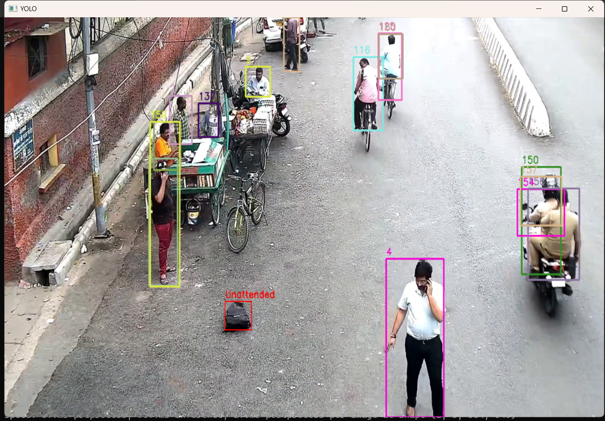
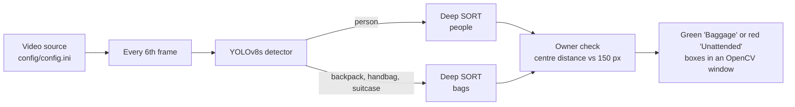

# Unattended Baggage Detection

Flags a bag in a video as unattended when the person who brought it moves away, using YOLOv8 for detection and Deep SORT for tracking.



*Output window from a test run. Numbered boxes are tracked people. That overlay is commented out in the current `bag_detect.py`, which draws only bag boxes.*

## Overview

Bags left behind in stations, markets and streets are a security concern, and they are easy to miss when one person watches many camera feeds. This script runs YOLOv8s on every sixth frame to find people and bags, and tracks each group with its own Deep SORT tracker so every person and bag keeps a stable ID. The first time a bag is seen, the nearest person within 150 pixels becomes its owner. From then on the bag is drawn in green while the owner stays within 150 pixels, and in red with the label "Unattended" once the owner is further away or no longer tracked.

## Highlights

- Detector: Ultralytics YOLOv8s (`models/yolov8s.pt`) using COCO class 0 (person) and classes 24, 26 and 28 (backpack, handbag, suitcase).
- Two Deep SORT trackers, one for people and one for bags, each with the `mars-small128.pb` appearance encoder (TensorFlow) and a cosine distance limit of 0.4 (`tracker.py`).
- Owner logic: bag-to-person assignment by bounding-box centre distance, stored in a `bag_to_person` map for the life of each bag track (`bag_detect.py`).
- Video source and the on-screen window are set in `config/config.ini`.
- Timing per processed frame is printed for YOLO and Deep SORT separately, with averages printed when the video ends.

## Architecture



## Tech stack

Python, Ultralytics YOLOv8, Deep SORT, TensorFlow (appearance encoder), OpenCV, NumPy.

## Quickstart

The repo has no requirements file. These are the packages the code and Deep SORT import:

```bash
git clone https://github.com/Kevinjoythomas/Unattended-Baggage-Detection.git
cd Unattended-Baggage-Detection
pip install ultralytics opencv-python numpy tensorflow scipy scikit-learn
```

Four things are needed that are not in the repo:

1. **Deep SORT source code in `deep_sort/`.** It is a git submodule (nwojke/deep_sort), so clone with `git clone --recurse-submodules`, or run `git submodule update --init` after cloning.
2. **`models/mars-small128.pb`**, the appearance model published with Deep SORT.
3. **`models/yolov8s.pt`**, the Ultralytics YOLOv8s weights.
4. **A video** at the path set by `source` in `config/config.ini` (default `AOD.mp4`).

```bash
python bag_detect.py   # press q in the window to stop
```

## Project structure

```
bag_detect.py       main loop: detection, tracking, owner check, drawing
tracker.py          Deep SORT wrapper (one instance for people, one for bags)
config/config.ini   video source and display settings
deep_sort/          Deep SORT submodule (nwojke/deep_sort)
img.png             example output frame
LICENSE             Apache License 2.0
```

## Limitations and next steps

- There is no time threshold: a bag is flagged on the first processed frame where its owner is more than 150 pixels away, so a brief step away raises a flag. Distance is in pixels, so the right value depends on camera height and zoom.
- `distance_from_bag` and `image_size` in `config.ini` are read but not applied: the distance is reset to 150 in `bag_detect.py` and the resize call is commented out. Wiring both settings through is a small next step.
- A bag first seen with nobody within 150 pixels never gets an owner and is marked unattended straight away. Output is limited to the on-screen label and a console message; no alert is sent anywhere.
- No test videos, labels or accuracy numbers are in the repo, and the exact Deep SORT version used is not recorded.

## License

Apache License 2.0, see [LICENSE](LICENSE). The Ultralytics package (AGPL-3.0) and Deep SORT (GPL-3.0) are separate dependencies under their own licenses.
